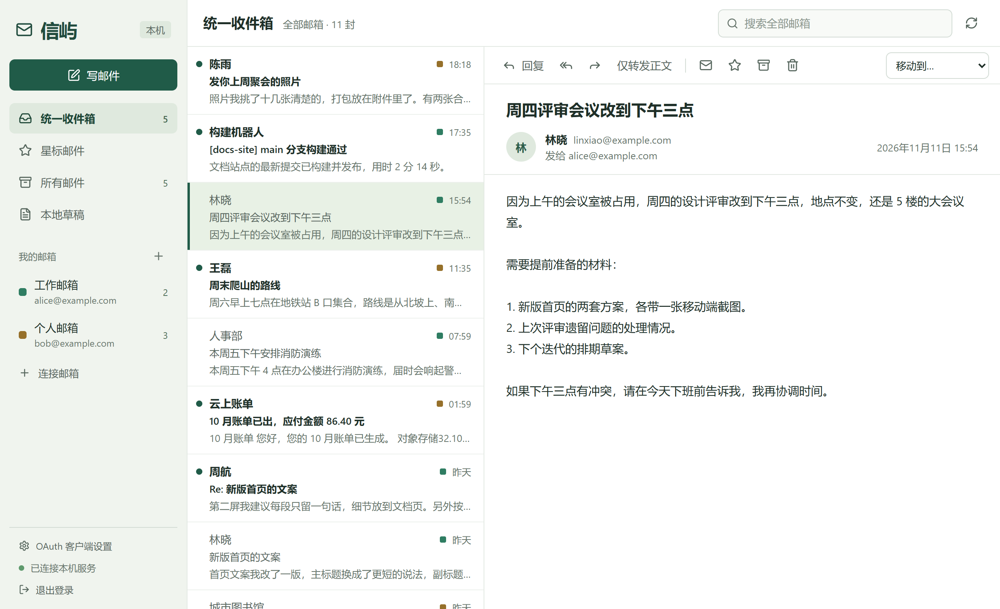

# 信屿 · MailIsle

信屿是一个运行在自己电脑或小主机上的多邮箱客户端。它把 QQ、163、Gmail、Outlook 等邮箱的邮件同步到这台主机，通过手机和电脑浏览器收信、搜索和写信。应用直接连接各家邮箱服务器，没有第三方中转服务；邮件索引和登录凭据保存在你部署信屿的主机上。



> **状态：开发中，尚未发布正式版本。** 支持部署到小主机，通过手机、电脑浏览器访问同一份邮箱数据。用真实账号验证过的目前有 QQ 邮箱的收信，以及 Gmail 和 Outlook 的 OAuth 授权，见[支持的邮箱](#支持的邮箱)。

## 功能

- **统一收件箱**：多个邮箱的来信合并在一个列表里，也可以按邮箱和文件夹查看；侧栏显示未读数。
- **跨邮箱搜索**：搜索主题、收发件人和正文。支持中文，两个字的词和单个字都能查到。
- **本地存储**：邮件索引保存在服务端 SQLite；打开过的邮件和附件缓存到主机磁盘。邮箱服务器离线时仍可读取已缓存内容，浏览器需要能连接信屿服务。
- **自动同步**：收件箱通过 IMAP IDLE 接收新邮件通知，其余文件夹每分钟检查一次。同时打开的多个浏览器窗口保持一致。
- **多端访问**：默认监听所有 IPv4 网卡，使用密码登录；手机恢复联网或返回前台时重新连接并刷新。登录状态保留 7 天，重启服务无需重新登录。
- **安全地阅读 HTML 邮件**：保留发件人的排版，但脚本、表单、外部样式和远程图片（包括追踪像素）一律屏蔽。随邮件附带的内嵌图片正常显示。
- **写信**：富文本、回复、全部回复、转发、抄送和密送、附件、本地草稿。写信时自动保存；登录过期后重新登录，正在写的邮件还在。
- **邮件操作**：已读、星标、移动、归档、移到已删除。
- **OAuth 登录**：Gmail 和 Outlook / Microsoft 365 使用 OAuth 登录。默认用 Thunderbird 的公开客户端，也可以换成自己注册的。
- **账号级代理**：每个邮箱可以单独设置 HTTP 或 SOCKS5 代理。
- **自动配置**：按邮箱后缀预填常见服务商的服务器参数，其他域名可在线查询 Thunderbird 的配置库。

## 支持的邮箱

所有邮箱都通过 IMAP 收信、SMTP 发信。

| 邮箱 | 登录方式 | 验证情况 |
| --- | --- | --- |
| QQ 邮箱 | 客户端授权码 | 已用真实账号验证同步和正文预取；发信待验证 |
| 网易 163 / 126 / Yeah | 客户端授权码 | 待真实账号验证 |
| Gmail / Google Workspace | OAuth，或应用专用密码 | 已用真实账号验证 OAuth 授权（Thunderbird 预置客户端） |
| Outlook.com / Hotmail | OAuth | 已用真实账号验证 OAuth 授权（Thunderbird 预置客户端） |
| Microsoft 365（工作或学校） | OAuth | 待真实账号验证；需要管理员允许 IMAP 和 SMTP AUTH |
| iCloud Mail | App 专用密码 | 待真实账号验证 |
| Yahoo Mail | 应用密码 | 待真实账号验证 |
| 其他 IMAP/SMTP 邮箱 | 密码 | 手动填写服务器，或使用「在线查找服务器」 |

“待真实账号验证”的服务商已有预设参数，并通过了本地测试服务器上的自动化测试，但还没有人用真实账号走通过。

## 快速开始

需要 Node.js 22.12 或更新的版本，以及 pnpm 10。目前在 Windows、Node.js 22.22.2 上验证过。

```sh
git clone https://github.com/sisi0318/mailisle.git
cd mailisle
pnpm install
```

把 `.env.example` 复制为 `.env`，将其中的 `MAIL_MASTER_PASSWORD` 改成自己的长密码（至少 12 个字符），然后：

```sh
pnpm build
pnpm start
```

本机打开 <http://127.0.0.1:3000>，手机或其他电脑打开 `http://小主机IP:3000`，用刚才设置的密码登录，点击「连接邮箱」。保存前应用会验证收信和发信两个连接。HTTP 本身不加密密码、会话和邮件；在不可信网络上传输时建议配置可选 HTTPS。

Docker、开机自启、HTTPS 与反向代理的配置见[部署与远程访问](docs/deployment.md)。

> **已有数据后不要直接修改 `.env` 中的主密码。** 它同时用于登录和加密邮箱凭据。需要修改时先停止服务，再运行 `pnpm password`，在本机隐藏输入新密码；工具会备份并重新加密已有凭据，邮件和草稿保留。仍没有忘记旧密码后的找回功能。

## 配置

通过 `.env` 文件或环境变量设置。

| 环境变量 | 默认值 | 用途 |
| --- | --- | --- |
| `MAIL_MASTER_PASSWORD` | 必填 | 登录密码，同时用来派生加密凭据的主密钥 |
| `MAIL_HOST` | `0.0.0.0` | 监听地址；`::` 用于 IPv6，`127.0.0.1` 限制为仅本机 |
| `MAIL_PORT` | `3000` | HTTP 监听端口 |
| `MAIL_DATA_DIR` | `.data` | 数据库、邮件正文和附件的存放目录 |
| `MAIL_PUBLIC_URL` | 不设置 | 用域名访问或反代时填写实际访问地址，如 `https://mail.example.com`；IP 直连无需填写 |
| `MAIL_TLS_CERT` / `MAIL_TLS_KEY` | 不设置 | 可选 PEM 证书与私钥路径，同时设置时应用直接提供 HTTPS |

必须设置自己的主密码，过短或全空格的密码无法启动。示例值不能用于对外监听，也不能用来创建新实例；只允许已有的旧实例在仅本机可达时（回环地址监听，且 `MAIL_PUBLIC_URL` 未指向外部地址）启动后迁移密码。域名反向代理需保留原始 Host；HTTPS 由反代提供时只需设置 `MAIL_PUBLIC_URL`，无需给应用配置证书。

## Gmail 与 Outlook 的 OAuth 登录

连接这两类邮箱时，应用会打开服务商的授权页。授权完成后浏览器跳回本机；如果浏览器和应用不在同一台机器上，可以把地址栏里的回调网址粘贴回应用。

默认使用 Thunderbird 的公开 OAuth 客户端，所以授权页显示的应用名是 **Mozilla Thunderbird**。这个预置值可能失效，也可能被组织管理员禁用。这时可以在侧栏的「OAuth 客户端设置」里换成自己注册的客户端：

- [注册自己的 Google OAuth 客户端](docs/oauth-google.md)
- [注册自己的 Microsoft OAuth 客户端](docs/oauth-microsoft.md)

## 安全

- 单用户实例，登录后可管理该实例的全部邮箱；数据 API、附件、OAuth 会话和实时事件流都需要登录。登录及会话状态查询是公开接口。
- IP 直连可用，域名需要配置 `MAIL_PUBLIC_URL`；校验请求来源，保留 HttpOnly / SameSite=Strict cookie。HTTPS 入口使用 Secure cookie。
- 登录尝试按客户端地址限速，未登录的请求只接受很小的请求体。
- 登录会话只将令牌摘要保存在数据库，7 天到期；退出当前设备不会退出其他设备，并立即关闭当前会话的实时事件流。
- 邮箱密码、授权码和 OAuth 令牌用 AES-256-GCM 加密后保存，密钥由主密码派生。
- 邮件 HTML 先清洗，再放进不能运行脚本的隔离框架里显示；框架自身的内容安全策略禁止任何网络请求。
- 邮件正文、附件和数据库本身**没有**加密。请保护好数据目录所在的磁盘。

## 已知限制

- 小主机必须保持运行且网络可达；监听所有网卡不会自动配置路由器、内网穿透或系统防火墙。
- 草稿保存在服务端，其他设备可以打开；不会同步到邮箱服务商的草稿箱，也不支持多人同时编辑合并。
- 远程图片只能屏蔽，没有“显示图片”的选项。
- 标记、移动等操作需要联网，断网时不会排队等待。
- 没有永久删除，只能移到已删除文件夹。
- 邮件缓存没有容量上限。移除邮箱时会删除它的缓存，服务器上已删除的邮件每小时清理一次。
- PWA、后台推送通知和两步验证尚未实现，HTTPS 为可选配置。

## 路线图

| 阶段 | 内容 | 状态 |
| --- | --- | --- |
| 1 | 通用 IMAP/SMTP、本地存储、统一收件箱、搜索、读写信、本机登录 | 已实现；已提供 Docker 构建文件，还差缓存容量管理和更多真实账号验收 |
| 2 | Gmail 和 Outlook 的 OAuth 登录 | 已实现；Gmail 和 Outlook 的授权已用真实账号验证，Microsoft 365 组织账号待验收 |
| 3 | 远程访问、可选 HTTPS、多端登录、PWA、新邮件通知 | 远程访问与会话持久化已实现；PWA、推送及可选两步验证待做 |
| 4 | 原生接口：Gmail API、Microsoft Graph、JMAP | 未开始，按需要做 |
| 5 | Proton 桥接、桌面壳 | 未开始，按需要做 |

## 开发

一个 Node.js 进程同时负责同步、HTTP API 和托管前端。代码是 pnpm workspace：

```
apps/server      进程入口：HTTP API、SSE、托管前端
apps/web         React 单页应用
packages/core    同步引擎、IMAP/SMTP 适配器、OAuth、写信
packages/db      SQLite 表结构、迁移、全文索引
packages/shared  前后端共用的类型和校验规则
```

开发时在两个终端里分别运行后端和前端，然后打开 <http://127.0.0.1:5173>：

```sh
pnpm dev        # 后端，监听 3000 端口，改动源码后自动重启
pnpm dev:web    # 前端开发服务器，把 /api 转发到 3000 端口
```

提交前运行：

```sh
pnpm check      # 类型检查
pnpm test       # 单元测试
pnpm build      # 生产构建
```

集成测试需要一个本地的 GreenMail 测试邮件服务器，不连接真实邮箱：

```sh
docker compose -f compose.test.yaml up -d
pnpm test:integration
docker compose -f compose.test.yaml down
```

没有 Docker 时的做法见[实现说明](docs/implementation.md#测试)。

## 文档

- [DESIGN.md](DESIGN.md)：技术方案、各家邮箱的接入方式、安全要求和路线图。
- [实现说明](docs/implementation.md)：当前版本的具体行为、边界情况和测试覆盖。
- [部署与远程访问](docs/deployment.md)：小主机、Docker、可选 HTTPS、开机自启和数据备份。
- [注册 Google OAuth 客户端](docs/oauth-google.md)、[注册 Microsoft OAuth 客户端](docs/oauth-microsoft.md)。

## 许可证

以 [Apache License 2.0](LICENSE) 发布。
